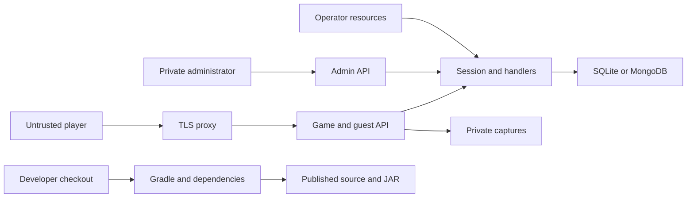

## Executive summary

Review date: 2026-11-16. Scope is the Java source proposed for the `java-server`
branch, not the deployed binary. The owner confirms public game access and private
admin access. Highest priorities are protecting guest device credentials and
requiring sessions, then bounding unauthenticated decode/capture workloads.
The review reproduced a direct guest-login alias substitution on isolated SQLite
and MongoDB. With owner approval, source now requires the exact stored device
before account updates/session issuance; regression tests failed before the fix.
This closes the demonstrated UID/canonical-alias path, not the residual risk of
a leaked real device credential. Purchase and Encore regressions verify atomicity, alias/replay rejection and
rollback, but do not establish full anti-cheat or deployment security. No live
attack traffic, account changes, configuration changes or deployment were used.

## Scope and assumptions

- In scope: `src/main/java`, relevant tests, `build.gradle`, publication ignore
  rules, example configuration and deployment guidance.
- Runtime: one Java service exposes game RPC, guest auth, admin, CDN and download
  routes (`server/GameServer.java`, `handle`, `get`, `post`). Paths below are
  relative to `src/main/java/emu/leman/ggserver/` unless otherwise specified.
- Owner-confirmed context: game public; admin private (VPN/allowlist/loopback).
  This is an operating assumption, not a verified firewall/proxy configuration.
- Guest device credential secrecy/entropy and any real payments or additional
  personal data remain unknown; owner asked to proceed with explicit assumptions.
  Treat device IDs, IPs, account state, session/admin secrets and captures as private.
- Assume untrusted players can edit/replay their own client requests, but cannot
  read server files, change the catalog, administer the DB or access private admin.
- Out of scope: APK changes, production exploitation/load testing, DB migrations,
  incident attribution and certification. No comprehensive dependency/CVE scan.
- Open questions: does the proxy strip/rewrite forwarding and local-proxy headers,
  deny direct origin access, enforce quotas/timeouts, and require TLS? Are guest
  IDs ever exposed to other players? Is more than one application writer deployed?

## System model

### Primary components

- Java 21 HTTP service and schema-based Base64/BZip2/Thrift codec:
  `server/GameServer.java`, `net/codec/Codec.java`, `net/codec/Thrift.java`.
- Guest login and server-issued sessions: `game/account/AuthApi.java#login`,
  `server/GameSessionLogin.java#login`, `server/SessionAccess.java#validate`.
- Feature handlers and serialized account operations:
  `net/HandlerRegistry.java#withAccountLock`, `game/economy/EconomyModule.java`,
  `game/content/ContentMusic.java` and `game/content/EncoreRules.java`.
- SQLite or MongoDB repository: `database/SqliteUserRepository.java`,
  `database/MongoUserRepository.java`, `database/MongoUserSections.java`.
- Privileged administration, operator resources and captures:
  `server/admin/AdminServer.java`, `data/ResourceLoader.java`,
  `server/GameServer.java#capture`.
- Developer/release plane: Gradle resolves Maven dependencies and produces JARs;
  source publication has separate secret/runtime exclusions (`build.gradle`,
  `.gitignore`, `SECURITY.md`, all relative to the repository root).

### Data flows and trust boundaries

- **B1 Internet → game HTTP listener:** auth forms, compressed RPCs and file GETs;
  HTTPS is assumed at the proxy, not proven. `HttpSupport.readBody` bounds expanded
  HTTP input to 64 MiB. Forwarded IP/domain/base headers are trusted without a peer
  allowlist (`server/GameServer.java#clientIp`, `baseUrl`). No application-wide
  rate/concurrency admission control is visible in this request path.
- **B2 guest identity/session → protected handlers:** device strings select guest
  identities; issued sessions are checked against all supplied account aliases.
  Bootstrap is public. Missing tokens fail only when `sessions.required` is true
  (`game/account/AuthApi.java#login`, `server/SessionAccess.java#validate`). Existing
  direct-login accounts now require an exact stored-device match before mutation
  and session issuance. The sanitized example sets true;
  `config/ServerConfig.java` defaults to false.
- **B3 private admin client → privileged HTTP routes:** password or signed token
  in bearer/cookie, JSON body <=1 MiB; protected routes gate before mutation.
  Cookies are HttpOnly/SameSite=Lax, but lack Secure; logout clears the cookie,
  not the signed token (`server/admin/AdminServer.java`, `AdminAuth.java`).
- **B4 handlers → account stores:** prepared SQLite statements and transactions,
  Mongo snapshot/CAS publication; in-process canonical-account locks serialize
  read/modify/save. Cross-process locking is not established by those Java locks
  (`database/SqliteUserRepository.java`, `MongoUserSections.java`,
  `net/HandlerRegistry.java`, `Services.java`).
- **B5 operator files → runtime / runtime → private filesystem:** manifest-driven
  catalog validation restricts paths/types/keys/counts; catalogs are operator-owned,
  not upload endpoints. Captures store decoded request/response state locally
  (`data/ResourceLoader.java`, `server/GameServer.java#capture`).
- **B6 developer checkout → dependency resolution → GitHub/artifacts:** Gradle
  dependencies are version-pinned but no dependency verification/locking appears
  in `build.gradle`. Ignore rules are not secret detection or history cleanup.

#### Diagram

## Assets and security objectives

| Asset | Why it matters | Security objective (C/I/A) |
| --- | --- | --- |
| Guest device IDs and sessions | May authorize access to account progress | C/I |
| Inventory, balances, receipts, progress | Prevent lost or duplicated grants and purchases | I/A |
| Admin password and signing key | Protect global event switches, grants and deletion | C/I |
| IPs, account data, captures and backups | Private player information and possible credentials | C/I |
| HTTP workers, heap, disk and database | Shared availability for all players | A |
| Catalog, dependencies and release artifacts | Define authoritative rewards and executable behavior | I |

## Attacker model

### Capabilities

Anonymous clients can send arbitrary HTTP/form/compressed payloads to the public
game surface and request guest sessions. A player can replay requests and race
their own account operations. Someone with a leaked device ID may impersonate a
guest; someone with a stolen admin token and private-network access can act as admin.

### Non-capabilities

No assumed access to private admin from the Internet, server filesystem, signing
key, database credentials, source publication credentials or arbitrary catalog
edits. No assumption that real-money payment processing exists in this service.

## Entry points and attack surfaces

| Surface | How reached | Trust boundary | Notes | Evidence (repo path / symbol) |
| --- | --- | --- | --- | --- |
| Game RPC and startup | Public POST | B1/B2 | Decode precedes session validation | `server/GameServer.java#post`, `rpc` |
| Guest/SDK auth | Public auth prefixes and game-session POST | B1/B2 | Device credential model, not provider signature verification | `game/account/AuthApi.java#handle`, `server/GameSessionLogin.java` |
| Admin login and mutations | Private HTTP routes | B3/B4 | Shared admin authority | `server/admin/AdminServer.java#handle` |
| CDN/APK/health/EULA and auth compatibility stubs | GET/HEAD/POST routes | B1/B5 | Fixed folders/basename resolution; no upload handler identified | `server/GameServer.java#get`, `game/account/AuthApi.java#handle` |
| Encoded payload parsers | RPC body | B1/B2 | gzip, BZip2, Thrift depth/count limits | `server/HttpSupport.java#readBody`, `net/codec/Codec.java`, `Thrift.java` |
| Local resources/captures | Operator files and request logging | B5 | Server-side files, not public file browsing | `data/ResourceLoader.java`, `server/GameServer.java#capture` |
| CLI/migration/build/publication | Operator/developer shell | B4/B6 | Not remotely reachable endpoints | `migration/`, root `build.gradle`, `.gitignore` |

## Top abuse paths

1. **Guest impersonation:** before this fix, send a known account UID/canonical
   alias as the direct guest credential → receive its session → act as that guest.
   Reproduced using synthetic stores; source now rejects those substitutions before
   account mutation or session issuance. A leaked actual device credential can
   still authorize guest login; its secrecy/entropy remains an open question.
2. **Session configuration downgrade:** operator omits/turns off required sessions
   → attacker supplies account aliases without a token → protected identity checks
   can be skipped. This is conditional on configuration, not a demonstrated bypass
   of `sessions.required: true`.
3. **Resource exhaustion:** unauthenticated requests enter decompression/Thrift
   parsing before session validation → concurrent bounded-but-large allocations or
   expensive nested decoding → heap/CPU pressure. Captures add unbounded disk growth.
4. **Header spoofing:** origin/proxy accepts attacker forwarding/local-proxy headers
   → server trusts IP/domain/base metadata → misleading account audit records or
   attacker-influenced bootstrap routing. This is not evidence of server-side SSRF.
5. **Admin credential misuse:** private-network access plus weak/default password
   or stolen token → powerful admin mutation. Existing signed tokens can survive
   logout until expiry; password bearer compatibility expands credential reuse.
6. **Economy replay/race:** replay aliases, stale save or concurrent reward claims
   → attempt duplicate grants or lost progress. Current locks, receipts and atomic
   saves mitigate tested cases; multiple writers/offline RNG remain residual risks.
7. **Release/private-file compromise:** privileged local actor changes resources
   or dependency inputs, or developer stages private runtime files → altered game
   behavior or disclosure through publication. This requires developer/operator
   capability; it is not a player-upload attack surface.

## Threat model table

| Threat ID | Threat source | Prerequisites | Threat action | Impact | Impacted assets | Existing controls (evidence) | Gaps | Recommended mitigations | Detection ideas | Likelihood | Impact severity | Priority |
| --- | --- | --- | --- | --- | --- | --- | --- | --- | --- | --- | --- | --- |
| TM-001 | Remote guest impersonator | Before fix: known repository alias. After fix: actual stored device credential | Obtain session as another guest | Account takeover | Progress, inventory, guest IDs | `AuthApi.login` now checks stored device before mutation and again on result; `SessionAccess` binds aliases; SQLite/Mongo before/after regression | Actual guest credential secrecy unknown; no independent provider proof | Deploy reviewed fix separately with authorization; plan verifiable guest secret/provider auth with client compatibility | Login identity anomalies without logging credentials | Low to medium residual, depends on real device exposure | High, account authority | medium |
| TM-002 | Remote alias claimant | Operator disables required sessions | Submit tokenless protected RPC | Unauthorized account mutation | Account integrity | Example requires sessions; `SessionAccess.validate` rejects missing tokens in strict mode | `ServerConfig` default false | Fail closed for public deployment; test effective config and reject unsafe startup mode | Startup security mode and tokenless protected-call alerts | Low under correct config | High, cross-account changes possible | medium |
| TM-003 | Anonymous resource abuser | Reach public game API | Repeated compressed/parser requests and captures | CPU/heap/disk exhaustion | Availability, private capture storage | 64 MiB limits in `HttpSupport`/`Codec`; Thrift depth 128/count cap | Large limits, decode before auth, virtual-thread-per-task executor, no capture retention here | Proxy body/rate/time limits; bounded decode concurrency; aggregate parser budgets and capture rotation | Decode latency, heap, queue, disk quota, rejects | High, no credentials needed; proxy controls unknown | High, shared-service outage | high |
| TM-004 | Header-spoofing client | Proxy passes client metadata or origin exposed | Supply forwarded/local-proxy headers | Audit/routing corruption | IP history, bootstrap metadata | `baseUrl` local-proxy syntax check | No trusted-peer enforcement | Strip/set headers at proxy; block direct origin; use configured public base/trusted proxies | Compare socket peer and effective header metadata | Medium, depends on proxy | Medium, no proven code execution | medium |
| TM-005 | Private-network or token thief | Admin network access and weak/stolen credential | Admin mutation or replay token after logout | Global grants/deletion/config changes | Admin secrets, all accounts | Password timing-safe comparison, HMAC expiry in `AdminAuth`; private-admin owner constraint | Legacy default/password bearer; no visible login throttle; no Secure cookie or server revocation | Strong independent secrets, private route enforcement, TLS/Secure cookie, login limits and revocation design | Failed logins and auditable privileged mutations | Low with private admin, rises on network/credential compromise | High, broad authority | medium |
| TM-006 | Authenticated cheating player | Own session, concurrent/replayed/stale saves | Duplicate grants or corrupt lifecycle | Economy/progress integrity loss | Balances, receipts, inventory | `HandlerRegistry` canonical locks; `EconomyModule` atomic grant/save; `EncoreRules`; repository transactions/CAS | Locks are per process; offline RNG not independently provable | Preserve tested controls; test multi-writer deployment if used; design server-issued operations for stronger anti-cheat | Duplicate/invalid receipt rejects, balance/grant consistency | Low for tested single-process cases | High, durable economy harm | medium |
| TM-007 | Compromised developer/operator or publication mistake | Local write or release authority | Modify resources/dependency inputs or publish private files | Supply-chain tamper or data disclosure | Catalog, artifacts, private files | `ResourceLoader` path/type/key/count checks; publication `.gitignore`; root `SECURITY.md` | Validation is not authenticity; ignores do not scan tracked files/history; no dependency verification shown | Least-privilege release credentials, staged secret scan, dependency verification and artifact provenance; protect local files | Release hash and staged-file inventory review | Low, privileged precondition | High, executable/data trust | medium |

## Criticality calibration

- **Critical:** practical unauthenticated control of all accounts; pre-auth remote
  code execution. Neither was demonstrated in this review.
- **High:** unauthorized guest takeover; sustained pre-auth shared-service resource
  exhaustion. The demonstrated alias substitution in TM-001 was high before the
  source fix; its residual priority depends on actual guest-credential exposure.
- **Medium:** forwarded-metadata spoofing without stronger exploit; admin token
  misuse requiring private-network access; economy races requiring untested
  multi-writer conditions after existing single-process protections.
- **Low:** low-sensitivity public metadata disclosure; malformed requests that
  reliably fail within bounded cost. Do not label a rejected payload a vulnerability.

## Focus paths for security review

| Path | Why it matters | Related Threat IDs |
| --- | --- | --- |
| `game/account/AuthApi.java`, `AuthContent.java` | Preserve exact-device validation before alias-resolving account creation | TM-001 |
| `server/GameSessionLogin.java`, `SessionAccess.java` | Device ownership, alias binding and strict-mode enforcement | TM-001, TM-002 |
| `config/ServerConfig.java` and root example config | Effective session/listener/secret deployment defaults | TM-002, TM-005 |
| `server/GameServer.java` | Pre-auth decode, trusted headers, captures, worker admission | TM-003, TM-004 |
| `server/HttpSupport.java`, `net/codec/` | Expansion, nesting, element and aggregate resource bounds | TM-003 |
| `server/admin/` | Shared admin authority and token/cookie lifecycle | TM-005 |
| `net/HandlerRegistry.java`, `database/` | Atomicity, locks and cross-process publication | TM-006 |
| `game/economy/`, `game/content/EncoreRules.java` | Purchases, receipts, cooldown and rollback invariants | TM-006 |
| `data/ResourceLoader.java` | Operator resource integrity and path confinement | TM-007 |
| Root `.gitignore`, `build.gradle`, `SECURITY.md` | Publication exclusions and dependency/release trust | TM-007 |

## Validation and quality check

- Owner clarification incorporated: public game/private admin; data sensitivity
  and guest secrecy unresolved. Findings are source-grounded and conditional,
  not claims about live compromise or verified production firewall controls.
- Covered all discovered HTTP route families plus local resource, DB, CLI and
  build surfaces; B1–B6 each map to threats above. Runtime and developer authority
  are separated; no remote catalog-edit/upload capability is assumed.
- Security-focused isolated suite: **100 tests passed**, including four new
  `CodecSecurityBoundaryTest` cases (bad encoding, count bounds, nesting,
  truncated/unknown Thrift types), plus session, HTTP/admin, catalog,
  SQLite/Mongo purchase and Encore regressions. Final sanitized publication,
  including the four added SQLite/Mongo guest-identity cases: **378/378 passed**,
  no failures/errors/skips; `test fatJar installDist` succeeded with JVM timezone
  UTC. See `RELEASE_NOTES.md` for publication build provenance.
- Additional owner-authorized guest-login regression: UID/u_id/canonical alias
  attempts reject without sessions/account changes; real stored devices and new
  guest creation remain supported on SQLite and Mongo memory. The narrow source
  fix changes no APK or live configuration and has not been deployed.
- Publication `detect-secrets` scan produced 32 candidates manually classified as
  public hash metadata, synthetic fixture IDs, example/test passwords and UI text.
  No private credential identified among those candidates; a separate tracked-file
  inventory excludes runtime/private artifacts. Neither check audits Git history
  or proves the absence of all secrets.
- No destructive/load probes, credentials in this report or production requests.
  Proxy controls, actual guest-credential secrecy, multi-writer safety and dependency vulnerabilities
  still require follow-up; passing these tests does not close those risks.
- Method: OpenAI `security-threat-model` skill and its prompt-template output
  contract, fetched from the requested public repository on the review date.
